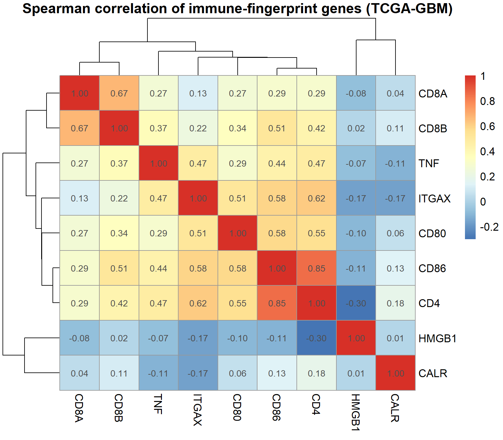
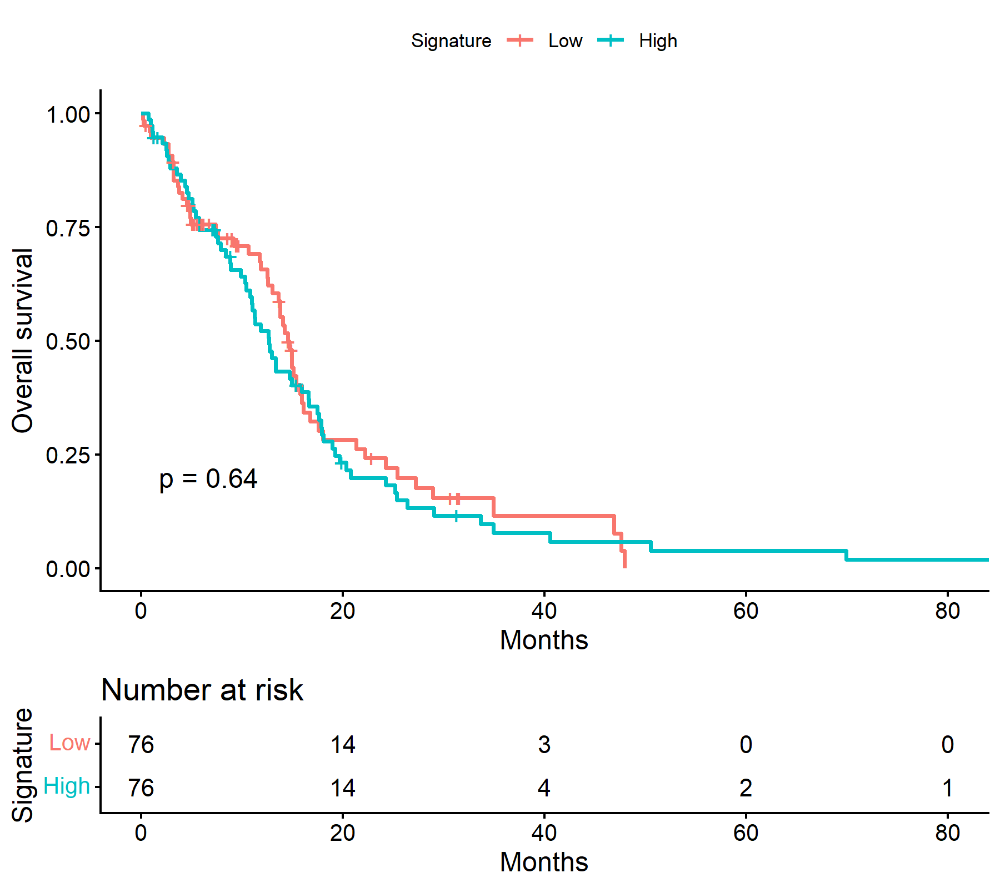
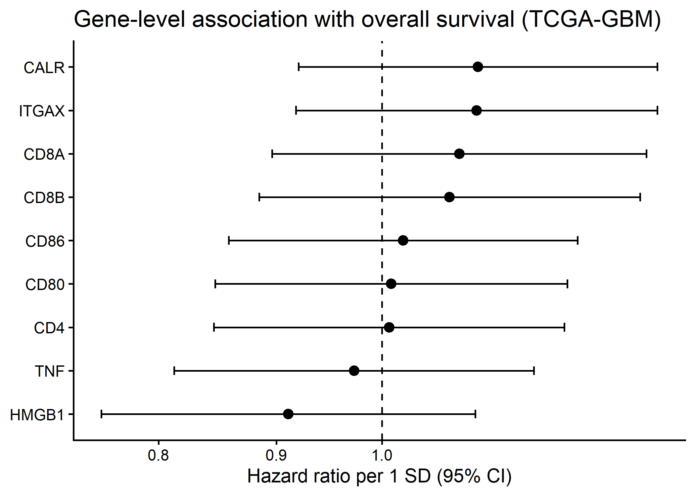

# TCGA-GBM Immune Gene Analysis

An R pipeline testing whether a small immune/immunogenic-cell-death gene panel
(HMGB1, CALR, CD80, CD86, TNF, ITGAX [CD11c], CD4, CD8A, CD8B) is associated with
overall survival in glioblastoma (TCGA-GBM, PanCancer Atlas).

The panel was fixed in advance from markers measured in a preclinical glioma
nanoparticle study. Genes, cohort and cut-point were not chosen after seeing results.

## Data
TCGA PanCancer Atlas GBM from [cBioPortal](https://www.cbioportal.org/datasets):
`gbm_tcga_pan_can_atlas_2018.tar.gz`. The data are not included here; please download
them yourself and follow the TCGA/cBioPortal terms of use.

## How to run
1. Put `gbm_tcga_pan_can_atlas_2018.tar.gz` in a working folder (do not extract it).
2. Open `glioma_immune_signature_TCGA.R` and set `setwd()` to that folder.
3. Install packages once: `install.packages(c("survival", "survminer", "pheatmap", "ggplot2"))`.
4. Run the script. Outputs are written to `results_GBM/`.

## Method (summary)
- RSEM RNA-seq (v2), primary tumours only (sample code 01), log2(x+1).
- Signature score = mean z-score across the genes.
- Kaplan-Meier with a median split; Cox models per 1 SD of the score;
  per-gene Cox with Benjamini-Hochberg correction.

## Results (this run)
- 153 primary tumours; 152 patients with survival data, 120 deaths.
- Signature vs overall survival: not significant
  (Cox, per SD: HR 1.05, 95% CI 0.88–1.26, p = 0.59; Kaplan-Meier median split, log-rank p = 0.64).
- Age is a strong prognostic factor (adjusted model, n = 106 with age recorded:
  HR 1.038 per year, p = 0.0002). The signature stays non-significant (HR 0.97, p = 0.78).
- The genes CD4, CD86, CD80, ITGAX, TNF and CD8 correlate with each other; HMGB1 and CALR do not.
  mRNA level cannot measure immunogenic cell death itself.

## Outputs
`fig1_gene_correlation.png`, `fig2_KM_signature.png`, `fig3_forest.png`,
`per_gene_cox.csv`, `sessionInfo.txt` (R 4.6.2, Windows 10).

## Limitations
Bulk mRNA of untreated tumours, single cohort, no external validation.
This is an observational analysis, not a test of any therapy.

## Notes
Code was written with AI assistance (Claude), then run and checked by the author.

## Author and license
Fatemeh Salahpour-Anarjan, PhD · Tabriz University of Medical Sciences 

## Visualizations

### 1. Gene Correlation Heatmap

### 2. Kaplan-Meier Survival Curve

### 3. Forest Plot for Gene-Level Cox Regression

